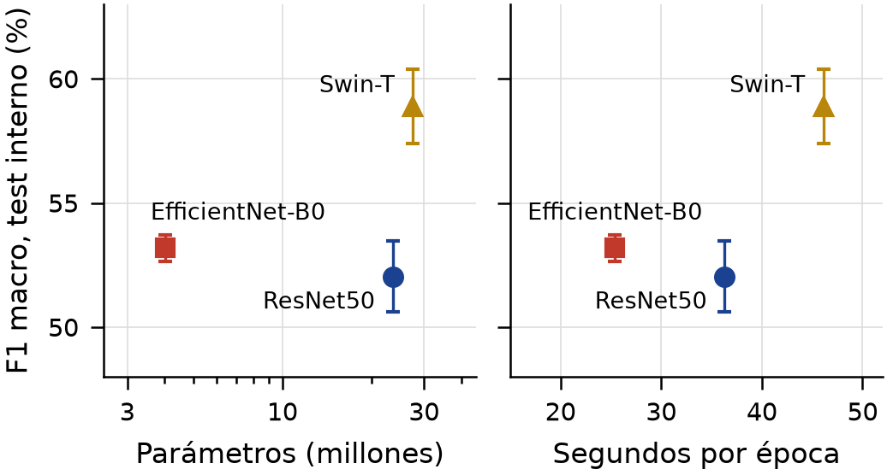
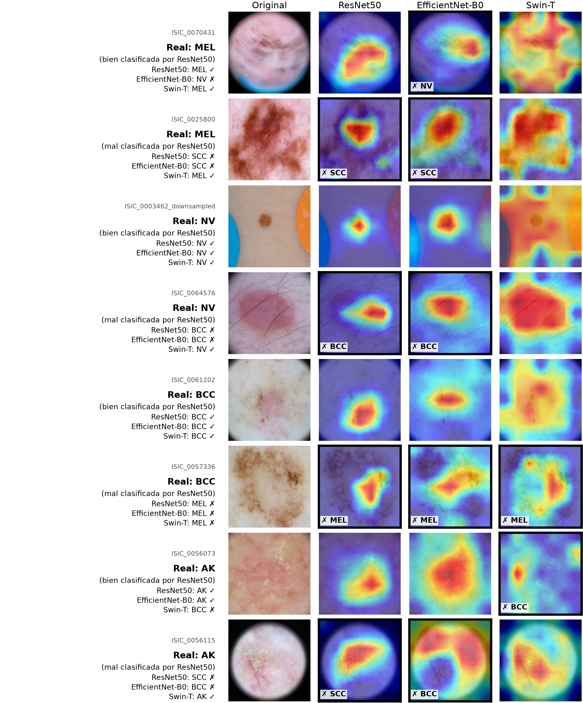

# isic2019-benchmark

English: [README.md](README.md)

Comparación de ResNet50, EfficientNet-B0 y Swin-T para clasificar lesiones cutáneas en ISIC 2019, con el mismo protocolo de entrenamiento y evaluación para los tres modelos.

## Resultados principales

Media ± desviación estándar de las semillas 0, 1 y 2, en porcentaje. El test interno es el 15% de la partición propia (3,798 imágenes) y el test oficial es el de ISIC 2019 sin la clase UNK (6,191 imágenes). Las ocho clases son melanoma (MEL), nevo melanocítico (NV), carcinoma basocelular (BCC), queratosis actínica (AK), queratosis benigna (BKL), dermatofibroma (DF), lesión vascular (VASC) y carcinoma escamocelular (SCC).

| Modelo | F1 macro, interno | F1 macro, oficial | Exactitud balanceada, interno | Exactitud balanceada, oficial | Parámetros (M) | GMACs | Inferencia (img/s) |
|---|---|---|---|---|---|---|---|
| ResNet50 | 52.0 ± 1.4 | 51.6 ± 0.9 | 56.6 ± 1.7 | 52.8 ± 1.1 | 23.5 | 4.1 | 1770 |
| EfficientNet-B0 | 53.2 ± 0.5 | 53.0 ± 1.2 | 54.1 ± 0.9 | 52.4 ± 2.1 | 4.0 | 0.4 | 3096 |
| Swin-T | 58.9 ± 1.5 | 58.5 ± 1.5 | 57.7 ± 0.9 | 55.6 ± 1.7 | 27.5 | 4.5 | 1189 |

Las cifras salen de `results/tables/tabla1_resultados.csv` y `results/tables/tabla2_costo.csv`. La inferencia se midió con batch 32 en una RTX 5070 Ti Laptop.



F1 macro del test interno contra el número de parámetros y los segundos por época (las barras son la desviación entre semillas).



Grad-CAM de la semilla 0 de cada modelo sobre dos imágenes de cada una de las clases MEL, NV, BCC y AK (una bien y una mal clasificada por ResNet50). Las otras cuatro clases están en `figures/gradcam_grid_2.png`.

Swin-T obtiene el mejor F1 macro en los dos tests (58.9 en el interno y 58.5 en el oficial, contra 52.0 y 53.2 de las CNN) y gana en 7 de las 8 clases, a cambio de la inferencia más lenta (1189 img/s) y de 46.1 s por época. EfficientNet-B0 llega a 53.2 con 4.0 M de parámetros y 0.4 GMACs, cerca de la décima parte del cómputo de los otros dos, y el ensemble de sus tres semillas sube a 56.7. Pasar del test interno al oficial cuesta menos de 0.5 pp de F1 macro en los tres modelos, pero de 1.7 a 3.8 pp de exactitud balanceada. En Grad-CAM las CNN se concentran en la lesión, mientras que los mapas de Swin-T salen en bloques de 7x7 que reflejan la partición en ventanas y a menudo cubren el fondo: el método sirve para comparar las CNN entre sí, no con Swin-T.

## Datos

Se usa ISIC 2019, con cinco archivos que se descargan de [challenge.isic-archive.com](https://challenge.isic-archive.com/data/):

| Archivo | Contenido |
|---|---|
| `ISIC_2019_Training_Input.zip` | 25,331 imágenes de entrenamiento |
| `ISIC_2019_Training_GroundTruth.csv` | etiquetas de entrenamiento (8 clases más UNK) |
| `ISIC_2019_Training_Metadata.csv` | metadata, incluido el `lesion_id` que usa la partición |
| `ISIC_2019_Test_Input.zip` | 8,238 imágenes del test oficial |
| `ISIC_2019_Test_GroundTruth.csv` | etiquetas del test oficial |

El código espera los datos en `~/data/isic2019/`, con los dos zip descomprimidos ahí mismo:

```
~/data/isic2019/
  ISIC_2019_Training_Input/            # 25,331 JPEG
  ISIC_2019_Test_Input/                # 8,238 JPEG
  ISIC_2019_Training_GroundTruth.csv
  ISIC_2019_Training_Metadata.csv
  ISIC_2019_Test_GroundTruth.csv
  img256/                              # lo genera scripts/preprocess.py
```

ISIC 2019 está bajo la licencia [CC-BY-NC 4.0](https://creativecommons.org/licenses/by-nc/4.0/): se puede usar con atribución y sin fines comerciales. La licencia MIT de este repositorio cubre el código, no los datos. La atribución que exige ISIC es:

- BCN_20000 Dataset: (c) Department of Dermatology, Hospital Clínic de Barcelona
- HAM10000 Dataset: (c) by ViDIR Group, Department of Dermatology, Medical University of Vienna; https://doi.org/10.1038/sdata.2018.161
- MSK Dataset: (c) Anonymous; https://arxiv.org/abs/1710.05006; https://arxiv.org/abs/1902.03368

Las referencias completas están en `paper/datasets.bib`. `figures/gradcam/` contiene 16 imágenes de ISIC 2019 (el recorte central de 224 px de la versión de 256 px) y sus 48 mapas de Grad-CAM; esas imágenes, igual que las rejillas `figures/gradcam_grid_*.png`, se redistribuyen bajo la misma licencia CC-BY-NC 4.0 y con la atribución de arriba.

## Método

Las 25,331 imágenes se redimensionan a 256x256 (bicúbica, JPEG calidad 95) y se dividen 70/15/15 (17,735, 3,798 y 3,798 imágenes) de forma estratificada por clase y agrupada por `lesion_id` con semilla 42, para que las imágenes de una misma lesión no queden en particiones distintas. El test oficial, sin sus 2,047 imágenes UNK, se usa solo como evaluación externa. Los tres modelos vienen de timm con pesos de ImageNet y una cabeza nueva de 8 clases, y se entrenan con el mismo protocolo: AdamW (lr 1e-4, weight decay 1e-2), una época de warmup y cosine decay, batch 32, un máximo de 15 épocas con early stopping (paciencia 3 sobre el F1 macro de validación), AMP en bf16, cross-entropy ponderada por la frecuencia inversa de cada clase y data augmentation ligera (RandomResizedCrop 224 con escala de 0.7 a 1.0, giros horizontal y vertical, rotación de hasta 20 grados, brillo y contraste de 0.1). Cada modelo corre con tres semillas, nueve corridas en total.

Experimentos complementarios, todos con la semilla 0:

- Convergencia: con un máximo de 30 épocas el early stopping cortó en las épocas 23, 19 y 18, con ganancias de +0.5, +1.1 y +3.1 pp de F1 macro interno (`results/tables/tabla5_convergencia.csv`).
- Ablación de la ponderación de clases: ni la raíz cuadrada de la frecuencia inversa ni la pérdida sin pesos mejoran el F1 macro de forma consistente, y sin pesos la exactitud balanceada interna cae 9.7, 4.3 y 3.4 pp (`results/tables/tabla6_ablacion_pesos.csv`).
- Ensembles por promedio de probabilidades softmax, sin entrenar nada más: el de las tres arquitecturas llega a 59.3 de F1 macro interno, debajo del de tres semillas de Swin-T, que llega a 60.5 (`results/tables/tabla4_ensembles.csv`).

## Estructura del repositorio

```
isic2019-benchmark/
  configs/
    base.yaml            # protocolo común: datos, augmentation, optimizador, épocas, semillas
    resnet50.yaml        # cada config de modelo solo cambia model.name
    efficientnet_b0.yaml
    swin_t.yaml
  src/isic/
    data.py              # Dataset, transforms y lectura de los splits
    models.py            # modelos de timm y capa objetivo de Grad-CAM de cada uno
    train.py             # entrenamiento, early stopping y smoke test
    evaluate.py          # métricas en test interno, test oficial y train
    cost.py              # parámetros, MACs, throughput y tiempos de entrenamiento
    ensemble.py          # ensembles desde las predicciones guardadas
    gradcam.py           # Grad-CAM sobre 16 imágenes fijas del test interno
    plotstyle.py         # colores, marcadores y nombres comunes de las figuras
  scripts/
    check_gpu.py         # verifica CUDA y bf16
    preprocess.py        # redimensiona a 256x256 en data/img256/
    make_splits.py       # partición 70/15/15 agrupada por lesion_id
    run_all.sh           # cola de las 9 corridas principales
    run_long.sh          # cola del experimento de convergencia (30 épocas)
    run_ablation.sh      # cola de la ablación de ponderación de clases
    status.sh            # estado de las tres colas
    pr_por_clase.py      # precisión y recall por clase desde las matrices de confusión
    make_figures.py      # tablas en CSV y LaTeX, figuras en PDF y PNG, summary.json
  results/               # métricas, splits, costo, ensembles, tablas y logs de las colas
  figures/               # figuras del artículo e imágenes de Grad-CAM
  paper/                 # artículo (articulo.tex, articulo.pdf) y bibliografía
  NOTAS.md               # notas de trabajo y observaciones para el artículo
  data -> ~/data/isic2019  # symlink, fuera de git
  runs/                  # checkpoints, historiales y logs de cada corrida, fuera de git
```

## Reproducir

Requisitos:

- Linux o WSL2 en Windows.
- Driver de NVIDIA compatible con CUDA 12.8 o posterior (las RTX de la serie 50 no funcionan con versiones anteriores) y al menos 4 GB de VRAM: el pico medido fue de 2.6 GiB, en Swin-T.
- [uv](https://docs.astral.sh/uv/), que instala Python 3.11 o 3.12 y las dependencias de `uv.lock`.
- Alrededor de 30 GB de disco para los zip, las imágenes, el entorno y los checkpoints.
- tmux, para lanzar las colas largas.

Los pasos, en orden. Los tiempos son los de la RTX 5070 Ti Laptop y salen de los logs de `results/`; los pasos sin tiempo no quedaron registrados.

1. Clonar e instalar:

   ```bash
   git clone https://github.com/Valdes10U/isic2019-benchmark.git
   cd isic2019-benchmark
   uv sync
   uv run python scripts/check_gpu.py
   ```

2. Descargar los cinco archivos a `~/data/isic2019/`, descomprimir los zip y enlazar los datos al repositorio:

   ```bash
   cd ~/data/isic2019
   unzip -q ISIC_2019_Training_Input.zip
   unzip -q ISIC_2019_Test_Input.zip
   cd -
   ln -s ~/data/isic2019 data
   ```

3. Preprocesar (escribe 25,331 y 8,238 imágenes en `data/img256/train` y `data/img256/test`):

   ```bash
   uv run python scripts/preprocess.py
   ```

4. Generar la partición en `results/splits/`. Con los mismos datos, `git diff --stat results/splits` no debe mostrar cambios:

   ```bash
   uv run python scripts/make_splits.py
   ```

5. Smoke test (500 imágenes de train, 100 de val y una época; escribe en `runs/smoke_resnet50/`). Se puede repetir con `configs/efficientnet_b0.yaml` y `configs/swin_t.yaml`:

   ```bash
   uv run python -m isic.train --config configs/resnet50.yaml --seed 0 --smoke
   ```

6. Las 9 corridas principales, cada una seguida de su evaluación en los dos tests (1 h 22 min; entrenar una corrida toma 8.6, 6.9 y 11.0 min en promedio para ResNet50, EfficientNet-B0 y Swin-T). La cola es reanudable: salta las corridas que ya tienen `metrics.json`.

   ```bash
   tmux new-session -d -s train "bash scripts/run_all.sh"
   ```

7. El experimento de convergencia (35 min). Se puede lanzar junto con el paso anterior, pues espera a que termine la cola principal:

   ```bash
   tmux new-session -d -s long "bash scripts/run_long.sh"
   ```

8. La ablación de ponderación de clases (44 min). Esta cola no espera a las otras, así que se lanza cuando termine la de convergencia:

   ```bash
   tmux new-session -d -s ablation "bash scripts/run_ablation.sh"
   ```

9. Revisar el avance de las tres colas:

   ```bash
   bash scripts/status.sh
   ```

10. Análisis, tablas y figuras, en este orden:

    ```bash
    uv run python -m isic.evaluate --all --split train   # F1 de train para la brecha de generalización
    uv run python -m isic.cost                           # results/cost.csv
    uv run python -m isic.ensemble                       # results/ensembles.csv y ensembles.json
    uv run python -m isic.gradcam                        # figures/gradcam/ y results/gradcam_images.csv
    uv run python scripts/pr_por_clase.py                # results/pr_por_clase.csv
    uv run python scripts/make_figures.py                # results/tables/, figures/ y results/summary.json
    ```

Las colas escriben sus logs y `env.txt` en `runs/`; los de `results/` son las copias de las corridas reportadas.

## Notas de reproducibilidad

- El entrenamiento usa `cudnn.benchmark = True` y AMP en bf16, así que repetir una corrida en el mismo hardware no da resultados idénticos bit a bit. Las diferencias se comparan contra la desviación entre semillas.
- La cola principal corrió con el commit `7fdf47a`, la de convergencia con `efe0280` y la ablación con `df720c8` (primera línea de cada log en `results/`). El código de entrenamiento no ha cambiado desde `df720c8`, y las opciones que agregaron esos commits (`--max-epochs`, `--run-name` y `--class-weight`) conservan el comportamiento original cuando se omiten.
- La columna GMACs es la salida de fvcore, que cuenta multiplicaciones-acumulaciones; en FLOPs estrictos la cifra es el doble, y `results/cost.csv` trae las dos columnas. fvcore no cuenta algunas operaciones (softmax, GELU y sumas en Swin-T; SiLU, sigmoid y multiplicaciones en EfficientNet-B0; max_pool en ResNet50), por lo que los MACs son una cota inferior ligera.
- El throughput de inferencia se midió con tensores sintéticos en la GPU, sin DataLoader, con batch 32. Los segundos por época excluyen la primera época.
- En Windows, el repositorio y los datos van en el sistema de archivos de WSL (ext4) y no en `/mnt/c`, pues leer desde NTFS es varias veces más lento. Dentro de WSL había 23 GiB de RAM y 8 GiB de swap (`results/env.txt`); esos límites se fijan en `%UserProfile%\.wslconfig`, con las claves `memory` y `swap` de la sección `[wsl2]`. Conviene entrenar con la laptop conectada y el modo de energía de Windows en máximo rendimiento: con batería la GPU baja su potencia y los tiempos por época dejan de ser comparables.

## Artículo

El artículo está en [`paper/articulo.pdf`](paper/articulo.pdf) (formato IEEE Conference, en español, 9 páginas). Para compilarlo con [tectonic](https://tectonic-typesetting.github.io/), que toma las figuras de `figures/` y la bibliografía de `paper/datasets.bib` y `paper/literatura.bib`:

```bash
cd paper
tectonic articulo.tex
```

## Limitaciones

- Los tres modelos comparten la misma tasa de aprendizaje (1e-4), y con ella ResNet50 queda subajustado (F1 macro de 72.0 en train, contra 90.2 de EfficientNet-B0 y 95.5 de Swin-T), así que su lugar en la comparación depende del protocolo.
- El nivel absoluto queda por debajo de lo publicado para ISIC 2019 (exactitud de 65.6 a 73.4); entre las causas probables están las imágenes de 224 px, las 15 épocas y la falta de metadata y de test-time augmentation.
- DF y VASC tienen 36 y 38 imágenes en el test interno: la desviación del F1 de DF va de 5.3 a 6.6 pp, y las diferencias entre modelos en esas clases no se interpretan.
- Solo hay tres semillas por modelo, y los experimentos complementarios usan una sola.
- En Swin-T los mapas de Grad-CAM heredan la geometría de las ventanas y la capa objetivo es una normalización, no una convolución, así que no se comparan con los de las CNN.

## Cita

```bibtex
@misc{valdes2026isic,
  author       = {Santiago Valdés Uriarte},
  title        = {Comparación de {ResNet50}, {EfficientNet-B0} y {Swin-T} para la clasificación de lesiones cutáneas en {ISIC} 2019 bajo un protocolo común},
  year         = {2026},
  howpublished = {\url{https://github.com/Valdes10U/isic2019-benchmark}},
  note         = {Maestría en Inteligencia Artificial y Ciencia de Datos, Universidad Panamericana}
}
```

## Contacto

Santiago Valdés Uriarte

- Correo: [santiago.valdesu@gmail.com](mailto:santiago.valdesu@gmail.com)
- GitHub: [Valdes10U](https://github.com/Valdes10U)
- LinkedIn: [santiagovaldesuri](https://www.linkedin.com/in/santiagovaldesuri)
